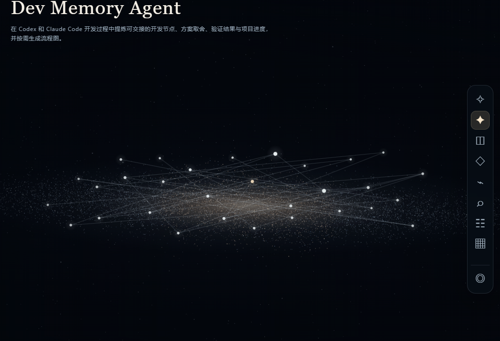

# Dev Memory Agent（开发记忆）

为 AI 编程助手保存**项目开发记忆**：把需求、实现、方案取舍和验证结果提炼为项目内的节点、进度与 Mermaid 流程图。记忆放在目标项目的 `.dev-memory/` 中，随项目代码一起交接；不会保存聊天原文。

## 能用在哪些 AI 平台

| 平台 | 使用方式 | 当前支持程度 |
| --- | --- | --- |
| OpenAI Codex（本地/桌面） | 安装插件，使用 skill 和生命周期 hook | 已实现并在本地验证 |
| Claude Code（本地 CLI） | 安装插件，使用 skill 和生命周期 hook | 插件格式与自动化测试已验证；仍建议在实际会话中试用 |
| 其他能运行命令的 AI 编程工具 | 让助手调用 `memory.py` CLI，或人工执行命令 | 手动集成；没有对应平台的自动 hook |
| 普通网页聊天（如 ChatGPT 或 Claude 网页聊天） | 无法直接访问本地项目文件 | 不支持直接安装或自动记录 |

运行环境：目标电脑需安装 Python 3.11+，并能用 `python` 命令启动。当前自动集成主要在 Windows 本地环境验证；其他系统请先检查 Python 命令与 hook 加载。

## 快速开始

先获取源码。以下命令从你存放项目的目录运行：

```bash
git clone https://github.com/hm-ai-game/dev-memory-agent.git
cd dev-memory-agent
```

为要记录的**目标项目**初始化一次（将路径和说明换成自己的）：

```bash
python memory.py init --project "C:\path\to\your-project" --name "我的项目" --goal "项目目标" --scope "当前范围"
```

该命令会创建目标项目的 `.dev-memory/`，并向其 `AGENTS.md` 加入项目级说明。已有记忆的项目无需重复初始化。建议将目标项目的 `.dev-memory/` 和 `AGENTS.md` 一起提交到目标项目仓库，以便其他开发者或 AI 助手接手；提交前自行检查其中是否含不适合公开的项目资料。

### 在 Codex 安装

从任意目录运行：

```bash
codex plugin marketplace add hm-ai-game/dev-memory-agent
```

然后在 Codex 桌面应用的 **Plugins Directory** 中找到 `Dev Memory (Local)`，安装 `dev-memory-agent`。在 Codex 中审核并信任 hook，重新开启目标项目会话。插件只在存在 `.dev-memory/project.json` 的项目中工作；未信任 hook 时仍可手动使用下面的 CLI 命令。

### 在 Claude Code 安装

从任意目录运行：

```bash
claude plugin marketplace add hm-ai-game/dev-memory-agent
claude plugin install dev-memory-agent@dev-memory-local
claude plugin list
```

在已初始化的目标项目中新开 Claude Code 会话。插件的 `SessionStart` 读取项目状态，`UserPromptSubmit` 为当前轮次生成 ID，`Stop` 检查是否记录了开发节点。Claude Code 的插件权限与 hook 信任由 Claude Code 管理。云端或远程 Claude Code 会话的插件加载尚未验证。

### 在其他 AI 编程工具中手动使用

让工具在目标项目里读 `AGENTS.md` 与 `.dev-memory/PROJECT.md`、`.dev-memory/STATUS.md`，并按 `skills/dev-memory/SKILL.md` 的规则，在完成实际开发工作后调用本仓库的 `memory.py`。这些平台不会自动触发本插件的 hook。

例如，从本仓库目录运行：

```bash
python memory.py status --project "C:\path\to\your-project"
python memory.py flow --project "C:\path\to\your-project"
python memory.py query "为什么选择" --project "C:\path\to\your-project"
python memory.py handoff --project "C:\path\to\your-project"
```

新增节点需先按 `skills/dev-memory/SKILL.md` 创建 UTF-8 JSON 输入文件，再执行：

```bash
python memory.py record --project "C:\path\to\your-project" --input "C:\path\to\your-project\.dev-memory\inbox\node.json"
```

已有节点可用 `revise --id <节点ID> --input <JSON文件>` 修订；旧版本会保留。

## 本地宇宙仪表盘

仪表盘展示你在本机添加的项目。公开仓库不附带预置项目、私人开发节点或项目路径；添加项目时填写自己的本地目录即可。每个项目的记忆仍保存在该项目自己的 `.dev-memory/` 中。

### 界面预览


*多项目宇宙首页。图中的 Project A–D 是界面示例；实际使用时显示你添加的项目。*



*单项目星云：亮星代表开发节点，连线展示节点关系。*

### 启动与添加项目

在 Windows 上，双击仓库根目录的 `start-dashboard.cmd` 即可启动；保留打开的命令窗口，关闭窗口后网页服务也会停止。下次使用时重新双击，然后刷新浏览器。此入口把项目列表保存在仓库的 `.dev-memory/.runtime/` 中。

在已启用开发记忆的项目目录运行：

```bash
python memory.py dashboard
```

浏览器会打开 `http://127.0.0.1:8765/`。打开 **Projects → 添加项目**，输入已初始化开发记忆的本地项目目录。也可以在启动时指定项目和端口：

```bash
python memory.py dashboard --project "C:\path\to\your-project" --port 8766
```

首页直接使用用户选定的四星云原图，图片文件保持原样。图中的示例导航和项目文字由可点击的网页元素覆盖，前四个位置显示已连接项目的真实名称和记忆数量；空位不可进入。顶部导航可打开项目管理、时间线、搜索和设置。超过四个项目时，新增项目也显示与前四个同样风格的名称和记忆数量标签，分布在现有四片星云上；同一位置标签较多时可滚动，不替换原图。缩放时限制最小倍率和平移范围，参考图边缘渐隐到黑色星空，在不同窗口比例和缩放下避免明显接缝。项目内部星云由画布绘制，没有图片边界；每颗亮星代表一个当前有效的开发节点，节点类型、重大影响与状态决定星星的大小和亮度。节点关系线默认可见，选中星星后与它相连的线会变亮。右侧工具栏提供宇宙、项目星云、进度、流程、时间线、搜索、交接、项目管理与重置视角。拖动画面可平移，滚轮以鼠标位置缩放；使用鼠标时自动漂移暂停，静止片刻后恢复。项目新增或节点更新会定期同步到画面。

仪表盘只监听本机 `127.0.0.1`，没有外部网页依赖。项目管理可添加已有 `.dev-memory/project.json` 的本地目录；本机列表只保存项目路径，开发记忆仍在各项目自己的 `.dev-memory/` 中。从列表移除项目不会删除项目文件。按 `Ctrl+C` 关闭服务；如果不希望自动打开浏览器，可加 `--no-open`。

## 工作原理与验证

插件源码位于 `plugin.json`、`.claude-plugin/`、`skills/`、`hooks/` 与 `memory.py`。设计细节见 [架构文档](docs/ARCHITECTURE.md)。项目记忆位于每个目标项目自己的 `.dev-memory/` 中，彼此隔离。

```bash
python -m unittest discover -s tests -v
claude plugin validate ./ --strict
```

## 许可证

本项目以 [MIT License](LICENSE) 开源。任何人都可以查看、使用、修改和再发布，但须保留许可证与版权声明。
